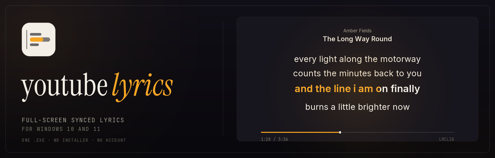
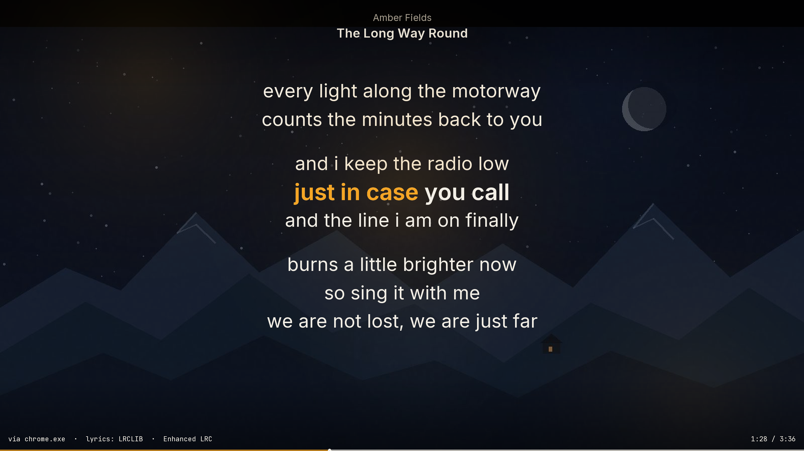
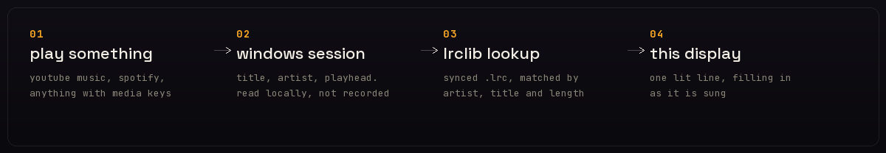

<div align="center">

<a href="https://youtube-lyrics-seven.vercel.app/downloads/YoutubeLyrics.exe"></a>
&nbsp; · &nbsp;
<a href="https://paypal.me/delinacre16"></a>

<br>

<strong>Windows 10 / 11 · 64-bit · Portable · No installer</strong>

<br><br>



<br>

**YouTube Music gives you a thin strip of small text at the side of the screen.**
**This gives you the whole screen, one lit line at a time.**

A single Windows executable that follows Windows' current music session,
prioritizing what is playing while retaining its current paused track. In desktop
wallpaper mode it sits behind the icons, does not take focus, and passes clicks
through. Four original cinematic backgrounds ship inside the executable — three drawn
stills and one procedural scene painted at runtime — with rotation and
readability preferences. Everything you can change is in one native settings
window (`Ctrl+Alt+S`), not buried in the tray menu. LRCLIB results are matched before display; lyrics.ovh is
an untimed fallback without response-side track metadata.

[](#requirements)
[](LICENSE)
[](https://github.com/LIN4CRE/Youtube-Lyrics/actions/workflows/ci.yml)

[**Download YoutubeLyrics.exe**][download] · [Help out via PayPal][support] · [Interactive design preview (simulated)](docs/preview.html) · [Shortcuts](#keyboard) · [Troubleshooting](#if-something-is-off)

</div>



<div align="center"><sub>Illustrative design render generated from the project's artwork — not a screenshot of the running Windows application. No runtime screenshot is claimed.</sub></div>

<br>

## About Youtube-Lyrics

Youtube-Lyrics is a free, open-source Windows desktop app that follows the
active media session and puts readable, timed lyrics on the desktop. It is a
native C++/Win32 executable—not a browser wrapper, YouTube Music modification,
video wallpaper, or background web page. It uses Explorer's WorkerW desktop layer
when available, passes clicks through, and can switch to an ordinary
window/full-screen view. WorkerW integration has not yet been runtime-tested on
Windows in this build environment.

It reads the track metadata Windows already publishes for media controls; it
does not capture or record audio, and it sends no telemetry. Lyrics are looked
up from LRCLIB, with an untimed lyrics.ovh fallback and optional local `.lrc` or
`.txt` files. The project is licensed under MIT.

YouTube Music's built-in lyrics panel is a narrow column, its text can be small,
and it does not always make the active line obvious. Youtube-Lyrics gives the
current line a clear visual focus, for singing along, learning a song, or
playing live. It works with media players that publish a Windows media session;
not every player does.

### Logo and icon

The original lyric-sheet mark is used throughout the app and project: [scalable
wordmark](docs/brand/logo.svg), [vector mark](docs/brand/mark.svg), [multi-size
Windows icon for shortcuts](docs/brand/YoutubeLyrics.ico), and PNG assets for the
app icon, repository avatar, and banner. `scripts/brand.py` and
`scripts/make_icon.py` generate them from the same ink-and-amber design; the
Windows executable embeds that same multi-size icon.

<br>

## What it does

| | |
| --- | --- |
| **The line you are on, lit** | The active line is 22 % larger, bright, and has a soft amber spotlight behind it. Lines fade with distance so the eye lands in the right place instantly. |
| **Timing shown honestly** | Genuine Enhanced LRC timestamps fill timed word/lyric segments. Ordinary LRC gets a continuous line-level wipe. Untimed text can use estimated line navigation, clearly labeled as estimated, with no fake karaoke wipe. |
| **Type you can read from the sofa** | Base size is 4.2 % of screen height and the column is capped at 1400 px. If a line would overflow, the whole layout steps down to fit rather than clipping. |
| **Smooth, not twitchy** | Lines scroll on a spring, so a fast chorus glides instead of jolting. Gaps of 3 s or more get extra breathing room, so verses and choruses separate themselves. |
| **Four themes, one of them honest** | Midnight (ink and amber, the default), Aurora, Ember, Mono. `T` cycles; the choice is remembered. |
| **Cover art, if you want it** | The album cover, aspect-filled and heavily darkened behind the text. `C` toggles. |
| **A real desktop layer** | Uses Explorer's WorkerW desktop surface when available; it does not take focus or intercept clicks. `Ctrl+Alt+W` switches wallpaper mode; `Ctrl+Alt+L` hides or restores it. A bottom-of-z-order fallback is used if WorkerW cannot be found. |
| **The right media session** | A playing session takes priority; Windows' current known music session remains visible while paused, with its position frozen. Stopped sessions are ignored, track changes are confirmed across polls, and lyrics are checked against title, artist and duration. |
| **One native settings window** | `Ctrl+Alt+S` (or **Settings…** in the tray) opens a compact Win32 window: display mode, theme, text size, sync offset, karaoke wipe, album-art tint, wallpaper choice, rotation, random launch and background darkness. No web view, no framework. |
| **Bundled scenes** | Three original cinematic stills plus a fourth procedural scene (*Drift*, drawn with GDI+ and costing no bytes) ship inside the executable. Cycle them with `B`, choose random launch, set rotation, and adjust darkness. |
| **Stable updates** | Checks the project's stable GitHub Releases at startup; it asks before downloading and verifies the manifest, SHA-256, size, and x64 executable before staging. No background service. |
| **Out of the way** | Runs in the tray; use the global hotkeys or the tray menu. Turn wallpaper mode off to use the normal full-screen/windowed display. |
| **Offline after the first play** | Lyrics are cached per track on disk. Replay a song on a plane and it still works. |

<br>

## Install

1. **[Download `YoutubeLyrics.exe`][download]** — one portable Windows x64 file; the current size and SHA-256 are shown below.
2. Put it anywhere: Desktop, `%LOCALAPPDATA%`, a USB stick. It is portable and
   writes nothing outside its own folder and `%LOCALAPPDATA%\YouTubeLyrics`.
3. Double-click it, then play something. No installer or administrator rights are needed.

Optional integrity check (PowerShell):

```powershell
Get-FileHash .\YoutubeLyrics.exe -Algorithm SHA256
```

Expected SHA-256 for the current 1.7.0 download is listed in [`YoutubeLyrics.exe.sha256`](docs/downloads/YoutubeLyrics.exe.sha256) and beside the download on the [project website](https://youtube-lyrics-seven.vercel.app/). Compare it before running the file. The checksum is served over HTTPS; it is an integrity check, not a code signature.

Windows may show **"Windows protected your PC"** because the file is not
code-signed. The source is public; continue only if you trust the download. If
you choose to proceed, select **More info → Run anyway**. No administrator
rights, services, or registry changes are required.

<a id="requirements"></a>

**Requirements:** Windows 10 (1809 or newer) or Windows 11, 64-bit. Nothing else
— no .NET, no runtime, no Python. The lyric listener uses the PowerShell that
ships with Windows.

<br>

## Using it

The default is desktop-wallpaper mode: the display attempts to sit on Explorer's
WorkerW desktop layer behind desktop icons, never takes focus, and passes clicks
through. If WorkerW is unavailable, it falls back to the bottom of the normal
window z-order. `Ctrl+Alt+W` switches between that and the foreground display;
`Ctrl+Alt+L` hides or restores it from any app, and `Ctrl+Alt+F` goes straight
to full screen from anywhere (including from the desktop layer). The wallpaper
behavior still needs runtime verification on Windows. `F11` or a double-click
toggles full screen/windowed, and `Esc` leaves full screen for a window; it
never hides the display. The window's size and position are remembered. `F1`
shows shortcuts and the
raw media-session state when the window is focused.

<a id="keyboard"></a>

| Key | Action | | Key | Action |
| :--- | :--- | :--- | :--- | :--- |
| `Ctrl`+`Alt`+`W` | Toggle desktop wallpaper mode | | `F` | Reset text size |
| `Ctrl`+`Alt`+`L` | Show / hide from any app | | `R` | Look the lyrics up again |
| `Ctrl`+`Alt`+`S` | Settings window | | `[` | Background darkness (cycles) |
| `F11` · `Ctrl`+`Alt`+`F` | Full screen ⇄ windowed | | `C` | Cover-art background |
| `Esc` | Close help, then leave full screen | | `K` | Karaoke wipe |
| `A` | Always on top (normal mode) | | `Q` | Quit |
| `↑` `↓` `+` `−` | Bigger / smaller text | | `T` | Theme |
| `←` `→` | This song earlier / later by 0.25 s (remembered) | | `F1` `H` | Help overlay |
| `D` | Save a diagnostic report | | | |

Double-clicking toggles full screen. Pressing `S` in the display (or `Ctrl+Alt+S`
from anywhere) opens the settings window; `F1` lists every shortcut. The tray
icon's right-click menu carries the same controls, wallpaper preferences, an
About dialog, a manual stable-update check, and an optional “Help out via PayPal”
link. Display settings are saved as you change them, and an open settings window
follows changes made from the tray or a hotkey instead of showing stale values.

### Desktop scenes

Three locally generated, original 1600×900 scenes (Rainfall District, Midnight
Range, Stillwood) are embedded in the executable, and a fourth — *Drift*, an
aurora over still water — is drawn procedurally at the moment the background
cache is built, so it adds nothing to the download. There are no hotlinked or
third-party wallpapers. Press `B` or choose **Next cinematic wallpaper** in the
tray menu to cycle them. Automatic rotation and a random wallpaper on launch are enabled by
default; the tray menu can turn either off, cycle the rotation interval (15, 30,
or 60 minutes), and change background darkness (0%, 12%, 24%, or 36%). These
preferences are stored locally.

### Stable updates

At startup the app quietly checks for a newer **stable release**: first the
release published with the project site (`youtube-lyrics-seven.vercel.app`),
then GitHub Releases. If there is a newer version, it asks before downloading;
use **Check for updates** in the tray menu or Settings to check manually. The
update must match the repository, stable tag/version, x64 architecture,
executable name, and declared size. The app compares the release manifest with
the separate SHA-256 file, verifies the downloaded bytes and 64-bit PE header,
stages the file, and uses a replacement helper that keeps a backup and restores
it if the new copy does not start. A download can be cancelled; files left by an
interrupted update are removed at the next start. It does not install previews
or run a background service. The checksum is obtained over HTTPS from the same
origin as the file; it is not a substitute for a code-signing certificate, and
the executable is unsigned.

Old copies that predate the site-first updater (anything showing version 1.5
or lower in its About box) only know about GitHub Releases, which has not
been kept up to date, so they must be replaced by hand once: download the
current file from the site and overwrite the old one.

The published file is reproducible: building the tagged source with the pinned
toolchain (`./scripts/build.sh`) produces the same SHA-256.

<br>

## Where the lyrics come from

The app tries [LRCLIB][lrclib] for an exact match, then broader and title-only
searches; those candidate results are scored before display. It then asks
lyrics.ovh for an untimed fallback. Standard LRC
provides line timestamps, so its active line gets a continuous line-level wipe.
When a source supplies Enhanced LRC inline timestamps, those genuine segment
times drive the finer wipe. Untimed lyrics may be paced across the reported song
length to aid navigation; the display labels that as **estimated scroll** and
does not represent it as source synchronization.

LRCLIB search results are scored against the detected title, artist and
available duration; weak matches are rejected. The lyrics.ovh fallback is
queried with the detected artist/title, but its response contains no track
identity metadata, so it cannot be independently verified and is a lower-confidence,
untimed source. Automatic results are cached on disk. For songs neither source
has (or when a result is wrong), add an
`.lrc` or `.txt` file under `%LOCALAPPDATA%\YouTubeLyrics\lyrics\` named
`Artist - Title.lrc` (or `.txt`). The tray menu can open that folder or clear the
automatic lyrics cache; local sheets take priority and are not copied into the
automatic cache. No account, audio capture, or telemetry is used. Lookups send
the detected title and artist; LRCLIB's exact-match request also includes album
and duration when Windows provides them. If no source has the song, `R` retries.

<br>

<h2 align="center">How it works</h2>



<div align="center"><sub>Nothing is recorded. The app never touches your audio — only the metadata Windows already publishes.</sub></div>

<br>

```
src/core/          portable logic: LRC parsing, JSON, track-name cleaning,
                   lyric layout and scroll maths  →  tests/core_test.cc
src/win/           Win32 window, tray, GDI+ renderer, WinHTTP, media listener
src/win/smtc.ps1   the PowerShell media-session listener (embedded in the exe)
scripts/build.sh   cross-compiles to dist/YoutubeLyrics.exe
scripts/generate_release.py creates strict stable-release metadata and checksum
docs/index.html    responsive no-terminal download page for GitHub Pages
docs/brand/        custom icon, vector logo, banner, badges and Windows .ico
src/win/wallpapers/ original procedural desktop scenes embedded in the app
AUDIT.md           engineering audit, verification, and residual risks
docs/downloads/    public Windows executable and SHA-256 sidecar
.github/           CI, stable release, Pages deploy, issue forms and funding
CHANGELOG.md       user-visible version history
CONTRIBUTING.md    build, test and contribution guidance
SECURITY.md        private vulnerability-reporting guidance
scripts/brand.py   draws the icon, logo, banner and preview art from code
scripts/test.sh    builds and runs the core tests under ASan/UBSan
docs/preview.html  an interactive browser mock of the display
```

The portable half is deliberately free of Windows headers and has its own test
suite covering LRC parsing, track matching, wrong-song rejection, lyric timing,
layout and scroll behaviour — so lyric maths can be checked on any machine, not
just a Windows one.

```bash
./scripts/test.sh     # core tests (ASan + UBSan), no Windows needed
./scripts/build.sh    # -> dist/YoutubeLyrics.exe
```

The only build dependency is [Zig][zig]: it bundles the MinGW-w64 toolchain and
its resource compiler, so the exe cross-compiles from Linux or macOS exactly as
it does on Windows. Icon and artwork generation additionally need Pillow and
`fonttools` (`pip install pillow fonttools brotli`, then `scripts/fetch_fonts.sh`).

<br>

## If something is off

<details>
<summary><b>It says "waiting for music" while something is clearly playing</b></summary>

<br>

The app reads Windows' media session. Playing sessions take priority; when
nothing is playing, the current known music session can remain visible while
paused so lyrics do not disappear immediately. A stopped/closed session is
ignored, and a paused non-current tab cannot mask another playing session. Press
`F1` in normal display mode to see the raw state the listener reported. Some
players (a few portable builds, older foobar2000) never publish a session and
cannot be supported.

</details>

<details>
<summary><b>No lyrics for a track I can see in YouTube Music</b></summary>

<br>

Press `F1` in normal display mode to see the exact title and artist the app
detected. YouTube Music sometimes reports `Artist - Topic` or a video suffix;
the app cleans the noise and scores LRCLIB results against the track metadata.
The lyrics.ovh fallback does not return identity metadata, so it cannot be
independently checked; if its result is wrong, add a local `.lrc`/`.txt`
override under `%LOCALAPPDATA%\YouTubeLyrics\lyrics\`. `R` retries. Remixes, live versions, karaoke and instrumental editions are
matched separately: a result tagged as a different edition of the same song is
rejected rather than shown, and the search asks for the edition the player
reports.

</details>

<details>
<summary><b>The words are consistently early or late</b></summary>

<br>

Some players report the playhead imprecisely, and some lyric files are just off
against a particular recording. Nudge with `←` `→`: the correction applies to
the song on screen and is remembered for that song. If *everything* is early or
late (a player that reports its position with a constant lag), set the
all-songs value in Settings instead. *Reset sync correction* in the tray menu
or Settings clears both. If a player publishes no playhead at all, the app runs its own clock from
the moment the track started, which is usually within a second. Untimed lyric
scroll is separately labeled as an estimate.

</details>

<details>
<summary><b>I want to report a problem</b></summary>

<br>

Press `D` in the display, or choose **Save a diagnostic report** in the tray
menu or Settings. A text file is written to
`%LOCALAPPDATA%\YouTubeLyrics\diagnostics\`, copied to the clipboard and shown
in Explorer. It lists the app and Windows versions, monitors, the display mode,
what the media session reported, each lyric request and why its result was
accepted or refused, the cache, the updater and the end of the log. It is not
sent anywhere. Your Windows account name is replaced with a placeholder, but it
does contain the titles of recently played songs, so read it before posting.

If the app will not start, run `YoutubeLyrics.exe --diagnostics report.txt`
from a terminal; that writes the report without opening a window and also
checks whether the lyric providers and update servers can be reached.

</details>

<details>
<summary><b>Nothing happens at all, or it exits immediately</b></summary>

<br>

Read `%LOCALAPPDATA%\YouTubeLyrics\ytlyrics.log`. Automatic cached lyrics live
beside it in `cache\`; local overrides go in `lyrics\`. Use the tray menu to
open the overrides folder or clear the automatic cache; deleting that cache
costs nothing but a re-download.

</details>

<details>
<summary><b>I want to see exactly what the listener hears</b></summary>

<br>

Run this in a terminal while a song plays:

```bat
powershell -ExecutionPolicy Bypass -File "%LOCALAPPDATA%\YouTubeLyrics\smtc.ps1"
```

It prints one JSON line every 400 ms with the selected playing session, title,
artist and playhead. This
is also the fastest way to tell whether a playback problem is in the app or in
Windows' media session.

</details>

<details>
<summary><b>A corporate policy blocks PowerShell</b></summary>

<br>

The listener is a small PowerShell script using the WinRT media-session API.
There is no packaged alternative that works in a single unsigned executable
without bundling a runtime, so if PowerShell is disabled by policy, listening
will not work. The display itself still runs.

</details>

<br>

## Help out

If Youtube-Lyrics is useful to you, you can support its ongoing development
through PayPal. Contributions are completely optional: the app will stay free,
open source, and usable without a donation.

<div align="center">
<a href="https://paypal.me/delinacre16"></a>
</div>

<br>

## Licence

MIT — do what you like with it. The lyrics themselves belong to their writers
and publishers: they are fetched from LRCLIB at runtime and never bundled here.
Typefaces in the artwork are under the SIL Open Font License (Instrument Serif,
Space Grotesk, JetBrains Mono, Inter).

<div align="center">
<br>
<sub>Built for people who would rather look at the song than at a column.</sub>
</div>

[download]: https://youtube-lyrics-seven.vercel.app/downloads/YoutubeLyrics.exe
[support]: https://paypal.me/delinacre16
[lrclib]: https://lrclib.net
[zig]: https://ziglang.org
